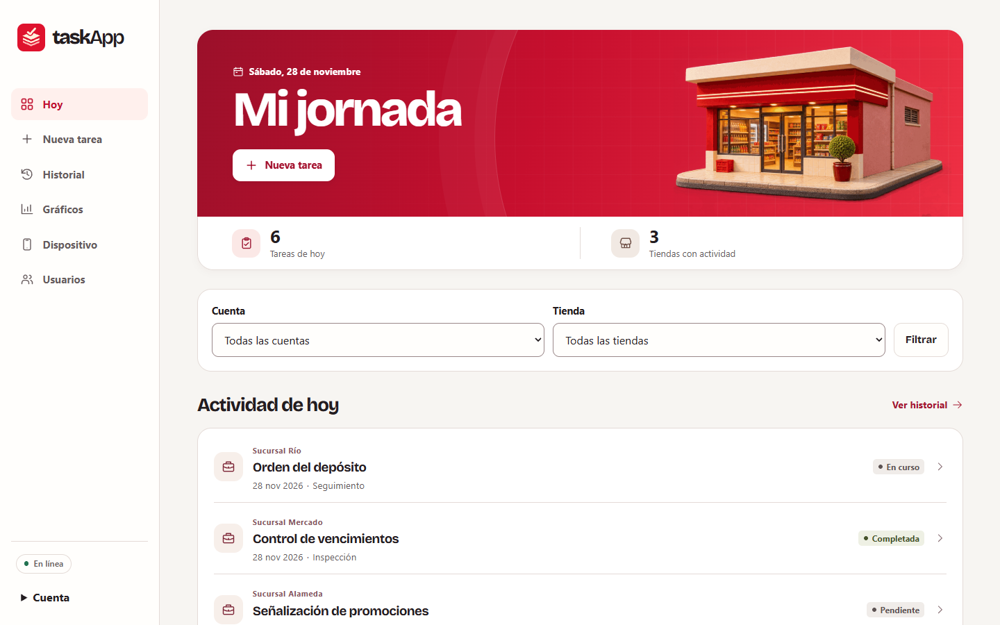
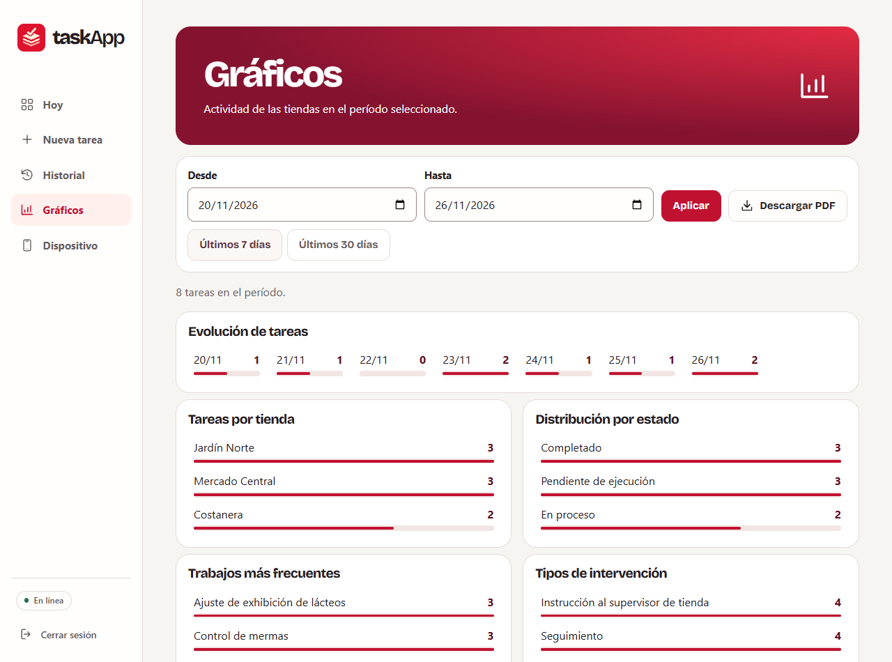
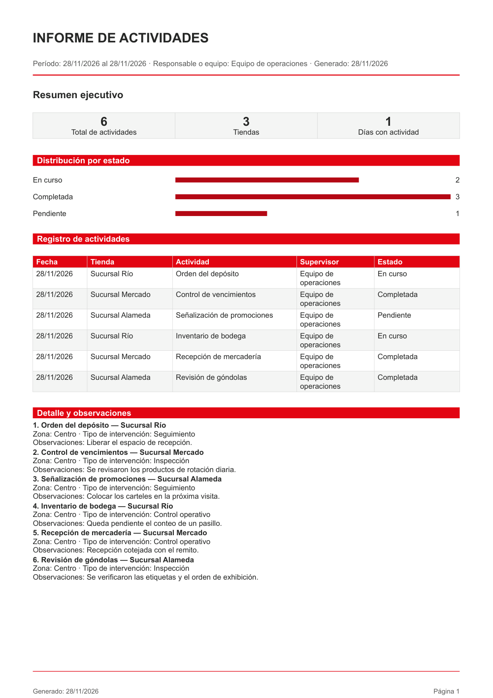

# taskApp


Registra cada trabajo desde la tienda. Al cerrar la jornada, puedes consultar qué se hizo, qué quedó pendiente y sacar un informe para compartir. taskApp es una aplicación privada para móvil y escritorio.

[Puesta en marcha](#puesta-en-marcha) · [Jornada](#la-jornada-en-tienda) · [Gráficos](#gráficos) · [Informes](#del-historial-al-informe) · [Uso sin conexión](#llevarla-en-el-móvil) · [Servidor](#despliegue-en-servidor)

## Puesta en marcha

Desde la raíz del proyecto, con Docker y Docker Compose instalados, ejecuta el siguiente comando.

```sh
docker compose up --build -d
```

Abre **[taskApp en esta PC](http://127.0.0.1:8080)**. Para pruebas locales, usa `admin` como usuario y contraseña. Si necesitas otro puerto, define `TASKAPP_PORT` en `.env`. Esta configuración permite el acceso desde esa misma PC.

La primera ejecución prepara un historial vacío y **33 opciones** tomadas de `Hoja1` del Excel original. Los nuevos registros se guardan en SQLite dentro del volumen `tasks` y se conservan al recrear el contenedor.

## La jornada en tienda

En **Hoy**, consulta cuántas tareas se registraron y en cuántas tiendas. Abre **Filtrar por tienda** para ver un local y toca **Nueva tarea** en la cabecera de la jornada. El formulario conserva la tienda elegida y propone la fecha de Paraguay. Escribe parte del nombre de un trabajo para buscarlo. Los campos de tienda, supervisor, zona, intervención y estado también sugieren opciones. Si necesitas una nueva, elige **Agregar** antes de guardar.

<picture>
  <source media="(max-width: 600px)" srcset="docs/media/mobile.png">
  
</picture>

[Ver captura móvil](docs/media/mobile.png) · [Ver captura de escritorio](docs/media/desktop.png)

## Gráficos

Elige el mes en curso, los últimos 7 o 30 días o un rango personalizado. Consulta la evolución de tareas, la actividad por tienda, los estados, los trabajos más frecuentes y los tipos de intervención. Toca una barra para ver las tareas que representa. El PDF descarga los cinco gráficos y el detalle de todo el rango.



[Ver gráficos en móvil](docs/media/charts-mobile.png) · [Ver el informe de muestra](docs/media/report.png)

## Del historial al informe

En **Historial → Exportar**, elige el primer y el último día. La descarga incluye ambas fechas y los registros guardados de todas las tiendas.

| Formato | Qué contiene |
| --- | --- |
| **Excel · .xlsx** | Una hoja **Tareas** con los campos del registro y las fechas del rango seleccionado. |
| **PDF · A4** | Un informe listo para compartir, con cinco gráficos, trabajos agrupados por fecha y observaciones completas. |

<details>
<summary><strong>Ver una página del informe PDF</strong></summary>



</details>

## Llevarla en el móvil

Abre la URL **HTTPS** del servidor desde el teléfono. En Chromium, elige la opción de instalar la aplicación en el menú del navegador. En Safari para iPhone, usa **Compartir → Agregar a pantalla de inicio**.

| Durante la jornada | Qué sucede |
| --- | --- |
| **Preparar la visita** | Al entrar con conexión se descargan los catálogos y las tareas de los últimos 30 días. La copia permite trabajar hasta ocho horas desde la última actualización. |
| **Trabajar sin señal** | Puedes registrar tareas y editar las que ya están en el dispositivo. En Gráficos puedes explorar las tareas confirmadas de la copia local. El historial completo y las exportaciones requieren conexión. |
| **Volver a tener señal** | Con la app abierta, los cambios se envían automáticamente. En **Dispositivo** puedes reintentar el envío o comparar dos versiones de una tarea y decidir cuál conservar. |

Si vence la sesión, vuelve a entrar con conexión para recuperar los cambios pendientes. **Cerrar sesión** borra los datos de ese dispositivo y pide confirmación si quedan cambios por enviar.

## Usuarios

La cuenta **admin** gestiona el acceso desde **Usuarios**. Cada persona trabaja con sus propias tareas y sugerencias. Admin puede consultar y exportar el conjunto. Consulta la [gu?a de usuarios, permisos y migraci?n](docs/usuarios.md).

## Despliegue en servidor

1. Crea un túnel de Cloudflare y dirige el dominio público a `http://app:8080`. Activa la redirección a HTTPS y guarda el token del túnel en `secrets/tunnel_token`.
2. Desde la raíz, ejecuta `cargo run --locked -- hash-password`. Elige una contraseña de al menos 15 caracteres. Guarda el hash Argon2id que imprime en `secrets/password_hash`, en UTF-8 sin BOM, y concede lectura al usuario del contenedor correspondiente. taskApp usa el UID `65532`.
3. En `.env`, asigna el dominio a `TASKAPP_ORIGIN`, por ejemplo `https://tareas.ejemplo.com`, sin barra final. Inicia los servicios.

   ```sh
   docker compose -f compose.prod.yaml up --build -d
   ```

4. Abre el dominio por HTTPS e inicia sesión como `admin` con la contraseña elegida.

> [!IMPORTANT]
> Conserva fuera de Git el Excel original, `.env`, los secretos y la base de trabajo. Para trasladar la instalación, detén la app antes de copiar el volumen completo de SQLite.

## Desarrollo

El servidor usa **Rust, Axum y Askama**. SQLite conserva las tareas y sus revisiones. La PWA guarda la copia de trabajo en IndexedDB. El servidor genera Excel con **rust_xlsxwriter** y PDF con **Typst**. Docker incluye Typst. Para exportar PDF al ejecutar con Cargo, instala Typst y déjalo disponible en el `PATH`.

```sh
cargo fmt --check
cargo clippy --locked --all-targets -- -D warnings
```
