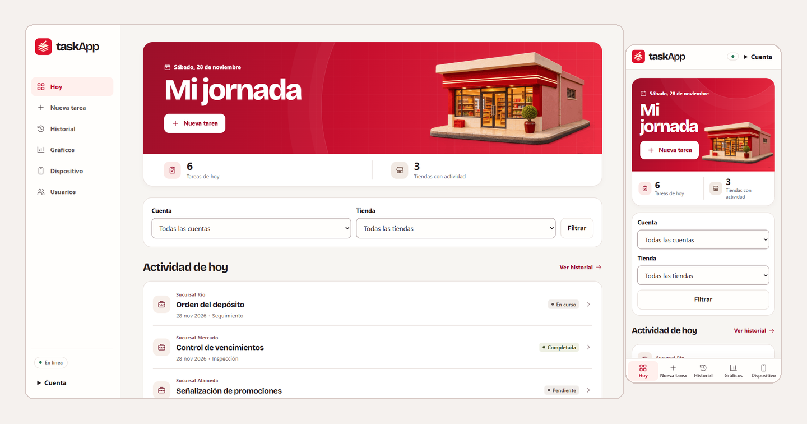

#  taskApp

**La bitácora de trabajo de tus tiendas.**

Registra lo que se hizo en cada sucursal, consulta lo que queda pendiente y comparte un informe de la jornada. taskApp es una aplicación de uso interno que instalas en tu propio servidor. Funciona en móvil y escritorio y permite seguir registrando tareas cuando se corta la conexión.


[Instalar](#instalación-rápida) · [Registrar tareas](#registro-de-tareas) · [Gráficos e informes](#gráficos-e-informes) · [Trabajo sin conexión](#trabajo-sin-conexión) · [Arquitectura](#arquitectura)



## Instalación rápida

Necesitas Git, Docker y Docker Compose.

```bash
git clone https://github.com/mateoschreiber/taskApp.git
cd taskApp
docker compose up --build -d
```

Entra en [taskApp local](http://127.0.0.1:8080). En un volumen nuevo de pruebas, el usuario y la contraseña iniciales son `admin`. El servicio local escucha solo en esta PC. Puedes definir `TASKAPP_PORT` en `.env` si el puerto 8080 está ocupado. SQLite guarda los datos en el volumen `tasks`, que persiste al recrear el contenedor.

Para un servidor compartido, usa el [despliegue de producción](docs/despliegue.md#producción), con HTTPS y una contraseña propia.

## Registro de tareas

En **Hoy** puedes ver los totales de la jornada, filtrar por tienda y abrir una tarea nueva con esa sucursal seleccionada. **Historial** muestra los registros del más reciente al más antiguo, con paginación y filtro por cuenta para el administrador.

1. Selecciona una sucursal en **Nueva tarea**.
2. Completa los datos generales. El formulario propone la fecha de Paraguay.
3. Completa el trabajo, el tipo de intervención, el estado y las observaciones del primer bloque. Usa **Agregar otra tarea** para sumar bloques de la misma sucursal.
4. Guarda el lote con un solo botón. Puedes registrar entre 1 y 100 tareas.

El servidor valida todos los bloques y guarda el lote completo en una transacción SQLite. Cada tarea tiene su propio registro y comparte los datos generales del lote. Si se reintenta el mismo envío tras una interrupción, el servidor devuelve los registros ya creados. Los catálogos ofrecen sugerencias al escribir y permiten agregar valores propios.

[Hoy en escritorio](docs/media/desktop.png) · [Hoy en móvil](docs/media/mobile.png) · [Formulario con dos tareas](docs/media/task-batch.png)

## Gráficos e informes

**Gráficos** resume el total de tareas, las tiendas con actividad y los recuentos por estado. Explora la evolución por fecha, las tiendas, los estados, los trabajos más frecuentes y los tipos de intervención. Selecciona una barra para abrir los registros que la componen. La evolución se agrupa por día, semana, mes o año según el período. Puedes consultar el mes en curso, los últimos 7 o 30 días o un rango propio. El administrador también puede filtrar por cuenta.


[Ver gráficos en móvil](docs/media/charts-mobile.png)

Desde **Historial → Exportar**, elige el período y el formato. Ambos extremos del rango se incluyen. El administrador puede exportar todas las cuentas o una sola. En **Gráficos**, también puedes descargar en PDF el período consultado en línea si tiene actividad.

| Formato | Contenido |
| --- | --- |
| [Excel · XLSX](docs/media/excel.png) | Hoja editable **Actividades** con encabezados, autofiltro y filas superiores inmovilizadas. |
| [PDF · A4](docs/media/report.png) | Informe con período, responsable o equipo, fecha de generación, resumen ejecutivo, distribución por estado, registro y observaciones. |

## Trabajo sin conexión

Abre la app con conexión e inicia sesión antes de ir a tienda. La PWA guarda el catálogo y las tareas propias de los últimos 30 días. La copia se puede usar durante ocho horas desde su última actualización.

- En **Dispositivo** puedes crear tareas, guardar lotes y editar registros disponibles en la copia. Los envíos pendientes se conservan por cuenta y se sincronizan con la app abierta al recuperar la conexión.
- **Gráficos** consulta las tareas confirmadas que estén dentro del rango de la copia. El historial completo, las exportaciones y los datos de otras cuentas requieren conexión.
- Puedes instalar la PWA desde el menú de Chromium o, en Safari para iPhone, desde **Compartir → Agregar a pantalla de inicio**.

Consulta [Usuarios y permisos](docs/usuarios.md) para administrar cuentas, revisar quién puede ver los registros y preparar un navegador compartido.

## Arquitectura

**Rust y Axum** sirven HTML con plantillas **Askama**. El navegador usa JavaScript nativo, un *Service Worker* para abrir las vistas offline e **IndexedDB** para la copia local y la cola. **SQLite** almacena las tareas, las cuentas y las sesiones. El servidor genera Excel con **rust_xlsxwriter** y PDF con **Typst**. Docker empaqueta la aplicación y sus herramientas de informes.

[Diagrama y arquitectura](docs/arquitectura.md) · [Despliegue y respaldos](docs/despliegue.md) · [Desarrollo y pruebas](docs/desarrollo.md) · [Cambios](CHANGELOG.md) · [Seguridad](SECURITY.md)
