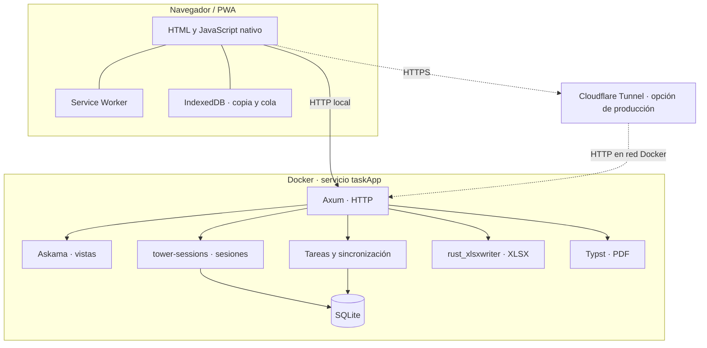

# Arquitectura

taskApp es una aplicación de un solo servicio. Axum atiende solicitudes y Askama renderiza HTML en el servidor. La PWA usa JavaScript nativo para mejorar la navegación, los formularios y la consulta de datos sin conexión.

## Código y persistencia

| Ubicación | Responsabilidad |
| --- | --- |
| [main.rs](../src/main.rs) | Configuración, rutas, migraciones, sesiones y recursos estáticos. |
| [auth.rs](../src/auth.rs) y [users.rs](../src/users.rs) | Inicio de sesión, credenciales, permisos, cuentas y auditoría de cambios de usuario. |
| [tasks.rs](../src/tasks.rs) | Jornada, historial, formularios, catálogo, lotes y sincronización. |
| [charts.rs](../src/charts.rs) y [charts.js](../assets/charts.js) | Agregación del período, gráficos, exploración de registros y cálculo sobre la copia local. |
| [exports.rs](../src/exports.rs) y [tasks.typ](../reports/tasks.typ) | Consulta por rango y cuenta, generación del XLSX y composición del PDF. |
| [templates/](../templates/) y [assets/](../assets/) | Plantillas, estilos, lógica del navegador y recursos de la PWA. |

Las [migraciones SQLx](../migrations/) definen tareas con fecha, tienda, supervisor, zona, trabajo, intervención, estado y notas. Las tareas pertenecen a una cuenta y tienen una revisión para detectar ediciones concurrentes. El catálogo inicial es compartido y cada cuenta conserva sus opciones adicionales. SQLite guarda las sesiones, las credenciales y los recibos de operaciones en la misma base.

## Alta de lotes y sincronización

El formulario envía los campos compartidos, hasta 100 bloques y un identificador de operación a `POST /api/tareas/lote`. El servidor abre una transacción SQLite `BEGIN IMMEDIATE`, valida la sesión y cada bloque, y guarda las tareas, las opciones nuevas y los recibos juntos. Si falla algún bloque, revierte todo. Si recibe otra vez el mismo identificador, devuelve los recibos de la operación ya confirmada.

El *Service Worker* almacena archivos estáticos y ofrece pantallas offline cuando la red falla. `GET /api/offline` devuelve el catálogo y las tareas propias de los últimos 30 días, hasta la fecha actual en Paraguay. [offline.js](../assets/offline.js) conserva esa copia durante ocho horas y separa las colas por cuenta en IndexedDB. La interfaz vuelve a intentar los envíos pendientes cuando recupera la conexión. Los lotes usan la misma ruta de alta. Las ediciones sincronizadas usan `POST /api/tareas/sync` y comparan revisiones. Si hay conflicto, **Dispositivo** permite revisar la versión del servidor antes de decidir qué conservar.

## Cuentas y alcance operativo

El servidor deriva la identidad de la sesión, comprueba el alcance de las consultas y valida CSRF en las operaciones de escritura. Argon2id protege las contraseñas. Las sesiones expiran tras ocho horas de inactividad. El administrador puede consultar los registros de otras cuentas y solo puede editar y sincronizar los propios. Los detalles de permisos y migración están en [Usuarios](usuarios.md).

SQLite es la fuente de verdad. La copia de cada navegador es parcial y las exportaciones se generan en el servidor. El Historial pagina por fecha e ID y permite al administrador filtrar por cuenta. La búsqueda de texto pertenece al autocompletado de catálogos en el formulario.

La evolución de los gráficos agrupa rangos de hasta 31 días por día, de 32 a 90 por semana, de 91 a 730 por mes y los superiores a 730 por año. Sin conexión, el rango se limita a las fechas de la copia del dispositivo. Typst ejecuta la plantilla de informe con los datos consultados para producir el PDF. Docker incluye el ejecutable y las fuentes necesarias para distribuirlo.
